**Sols Wiki** is a free desktop app for **[Sol's RNG](https://www.roblox.com/games/15532962292)** on Roblox. It packs the whole Sol's RNG Wiki into one fast,
good-looking program – every aura, biome, gear, item, quest and cutscene – and lets you roll for auras yourself. After the first start everything works offline.

> [!NOTE]
> Windows may say *"Windows protected your PC"* the first time, because the app is not code-signed. Click **More info → Run anyway**.

<b>Requirements</b>

- Windows 10 or 11, 64-bit
- Microsoft Edge WebView2 (already part of Windows 11)
- About 5 GB of free space and internet for the first start

<b>FAQ</b>

**Where are the files?** In `%LOCALAPPDATA%\Programs\Sols Wiki`; settings and your roll progress in `%APPDATA%\SolsWiki`.

**How do I uninstall it?** Settings → *Uninstall*. This removes the app, all pictures and the settings.

**Do I get updates?** Yes. New auras and data arrive automatically; for a new app version you get a notice with a download button.

**Does it touch the game?** No. Sols Wiki is a separate program and never interacts with Roblox.

Texts and pictures come from the <a href="https://sol-rng.fandom.com/">Sol's RNG Wiki</a> (CC BY-SA) and belong to their authors and the makers of Sol's RNG. 
Sols Wiki is a fan project and is not affiliated with Sol's Studio or Roblox. · made by <b>tcbi</b>

