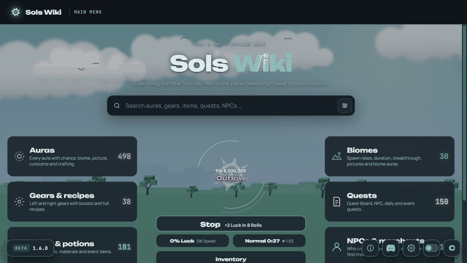
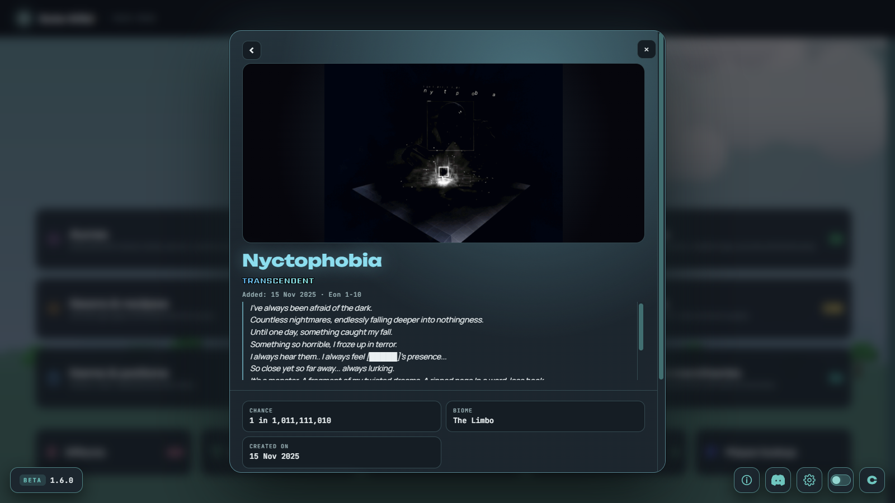
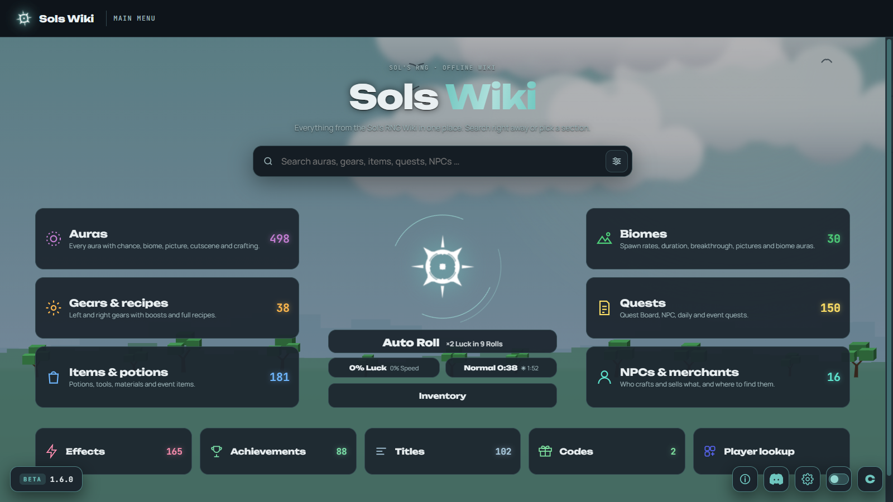
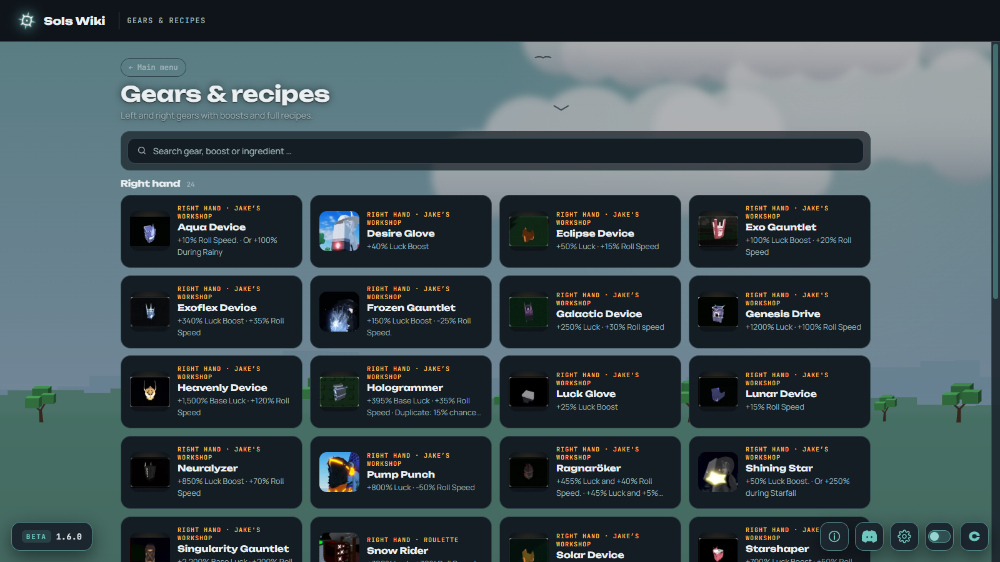

  

oder unter <a href="https://github.com/tcbixo/Sols-Wiki/releases/latest">Releases</a> · eine einzige Datei, kein Admin-Recht nötig

  

<a href="#-was-ist-sols-wiki"><b>Über die App</b></a> &nbsp;·&nbsp;
<a href="#-so-sieht-sie-aus"><b>Vorschau</b></a> &nbsp;·&nbsp;
<a href="#-installation"><b>Installation</b></a> &nbsp;·&nbsp;
<a href="#-was-liegt-in-diesem-repo"><b>Repo-Inhalt</b></a>

 

## ✦ Was ist Sols Wiki?

**Sols Wiki** ist eine Desktop-App für **[Sol's RNG](https://www.roblox.com/games/15532962292)** auf Roblox. Sie packt das komplette
Sol's-RNG-Wiki in ein schnelles, schön gestaltetes Programm – mit allen Auren, Biomen, Gears, Items, Quests und Cutscenes.
Nach dem ersten Start funktioniert alles **offline**, und neue Auren kommen automatisch über dieses Repo dazu.

<table>
<tr>
<td width="50%" valign="top">

### 🌌 Alles aus dem Wiki
**498 Auren** mit Chance, Biom, Bild, Cutscene und Rezept ·
**30 Biome** mit Dauer und Breakthrough ·
**38 Gears** und **181 Items** mit allen Zutaten ·
Quests, NPCs, Effekte, **88 Achievements** und **102 Titel**

</td>
<td width="50%" valign="top">

### 🎲 Selbst rollen
Auto Roll direkt im Hauptmenü, mit echten Chancen, Luck, Breakthrough,
Biom- und Tag/Nacht-Wechsel. Deine Sammlung, Gears und Auren-Crafting –
der Spielstand bleibt verschlüsselt auf deinem PC.

</td>
</tr>
<tr>
<td valign="top">

### 🎨 Im Sol's-RNG-Stil
28 animierte Biom-Hintergründe, Tier-Farben wie im Spiel, Cutscenes mit
angeglichener Lautstärke, Deutsch und Englisch, Textgröße, FPS-Regler
und vieles mehr in den Einstellungen.

</td>
<td valign="top">

### ⚡ Immer aktuell
Codes werden live geprüft, Achievement-Besitzer kommen live von Roblox.
Neue Auren und Bilder lädt die App selbst aus diesem Repo, und bei einer
neuen Version zeigt sie dir einen Update-Hinweis.

</td>
</tr>
</table>

## ✦ So sieht sie aus

<i>Auto Roll im Hauptmenü – mit echten Chancen, Biom-Timer und Luck</i>

 

<table>
<tr>
<td></td>
<td></td>
</tr>
<tr>
<td></td>
<td></td>
</tr>
</table>

## ✦ Installation

1. **[Sols-Wiki.exe herunterladen](https://github.com/tcbixo/Sols-Wiki/releases/latest/download/Sols-Wiki.exe)** und starten (am besten auf den Desktop legen).
2. Beim ersten Start lädt die App alle Bilder und Cutscenes (~5 GB) – das Fenster zeigt dir den Fortschritt.
3. Fertig. Ab jetzt startet die App in Sekunden, auch ohne Internet.

> [!NOTE]
> Windows kann beim ersten Öffnen „Der Computer wurde durch Windows geschützt“ anzeigen, weil die App nicht signiert ist.
> Dann auf **Weitere Informationen → Trotzdem ausführen** klicken.

<b>Systemanforderungen</b>

- Windows 10 oder 11, 64 Bit
- Microsoft Edge WebView2 (bei Windows 11 schon dabei)
- ca. 5 GB freier Speicher, Internet beim ersten Start

<b>Häufige Fragen</b>

**Wo landen die Dateien?** Unter `%LOCALAPPDATA%\Programs\Sols Wiki`, Einstellungen und Spielstand unter `%APPDATA%\SolsWiki`.

**Wie deinstalliere ich die App?** Einstellungen → *Deinstallieren*. Das entfernt die App, alle Bilder und die Einstellungen.

**Bekomme ich Updates?** Ja. Neue Auren und Daten kommen automatisch, für eine neue App-Version erscheint ein Hinweis mit Download-Knopf.

**Läuft das im Spiel mit?** Nein. Sols Wiki ist ein eigenes Programm und greift nicht auf Roblox zu.

## ✦ Was liegt in diesem Repo?

| Ordner / Release | Inhalt |
|---|---|
| `images/` | Alle Bilder der App, sortiert nach `auras`, `items`, `gears`, `biomes`, `titles`, `achievements`, `effects`, `npcs`, `quests` |
| `data/` | Die Wiki-Daten der App (Auren, Items, Biome …) – verschlüsselt, nur die App liest sie |
| `docs/` | Banner und Screenshots dieser Seite |
| Release **Beta x.y.z** | Die App selbst (`Sols-Wiki.exe`) |
| Release **Cutscenes** | Alle Aura- und Biom-Cutscenes (Videos), lädt die App beim ersten Start |

<a href="#top">↑ nach oben</a>

Texte und Bilder stammen aus dem <a href="https://sol-rng.fandom.com/">Sol's RNG Wiki</a> (CC BY-SA) und gehören ihren Autoren bzw. den Machern von Sol's RNG. 
Sols Wiki ist ein Fanprojekt und steht in keiner Verbindung zu Sol's Studio oder Roblox. · made by <b>tcbi</b>

  

<b>English:</b> Sols Wiki is a free offline desktop wiki for the Roblox game Sol's RNG – every aura, biome, gear and item, cutscenes,
an aura roller and live codes. <a href="https://github.com/tcbixo/Sols-Wiki/releases/latest/download/Sols-Wiki.exe">Download for Windows</a>.

